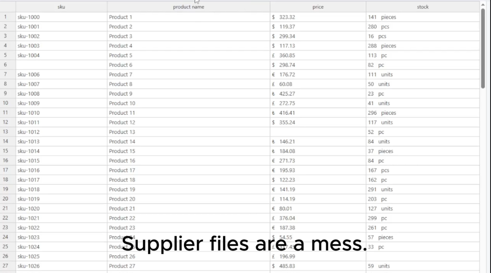

# FeedVexa

**Clean Supplier Data. Simplify Your Workflow.**

FeedVexa is a Windows desktop application designed to help e-commerce sellers organize and clean supplier CSV and Excel files.

Managing supplier product data can be time-consuming. Different column names, inconsistent price formats, and messy stock values often require manual corrections.

FeedVexa aims to make this process simpler with a straightforward desktop workflow.

## Features

- **CSV & Excel Support** — Import and export supplier data files.
- **Supplier Profiles** — Configure column mappings for different suppliers.
- **Data Cleaning** — Designed to standardize product prices, stock values, and other data fields.
- **Simple Workflow** — Focus on practical, repeatable data processing.
- **Desktop Application** — Built for Windows.

## Technology Stack

- C#
- Windows Forms (WinForms)
- Guna.UI2
- ClosedXML
- Newtonsoft.Json

## Project Status

FeedVexa is currently under development.

Features and workflows are being improved and tested.

## Who Is It For?

- Dropshipping sellers
- Small e-commerce businesses
- Online store owners working with supplier spreadsheets
- Anyone who regularly processes product CSV or Excel files

## Vision

The goal of FeedVexa is to reduce repetitive spreadsheet work and make supplier data easier to manage.

---

**FeedVexa — Clean Data. Work Smarter.**
